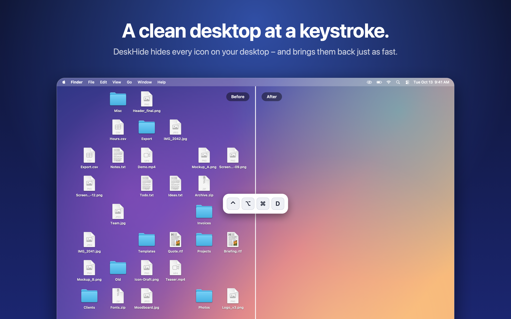

# DeskHide



DeskHide hides every icon on your Mac's desktop with a keyboard shortcut and brings them back the
same way – handy for clean screenshots, screen recordings and presentations. Nothing is moved or
deleted; the icons are only taken out of view.

**[Download DeskHide](https://github.com/Ocean198/DeskHide/releases/latest)** – free, for Macs with
Apple silicon running macOS 14 or later. Unzip, drag DeskHide to Applications, open it. The app is
notarized by Apple.

DeskHide was developed and tested on macOS 27. If hiding instantly does not work on another version,
use the "Hide Completely" option described below.

## How it works

There are two ways of hiding, and you choose between them in the menu.

**Instantly (default).** DeskHide flips the system setting behind "Desktop & Dock › Show Items: On
Desktop". Finder keeps running and the change takes effect at once. macOS only honours that setting
while "Click wallpaper to reveal desktop" is set to "Always", so DeskHide switches that on while the
icons are hidden and puts your own choice back afterwards. One consequence: anything that reveals the
desktop – a hot corner, the trackpad gesture, a click on the wallpaper – brings the icons back for as
long as the desktop is revealed.

**Hide Completely (Restarts Finder).** Finder stops drawing a desktop at all, so the icons stay away
even when the desktop is revealed. The price is that Finder restarts every time you toggle, which
takes about a second and closes open Finder windows. If Finder is busy copying files, DeskHide leaves
everything as it is and tells you, rather than interrupting the copy.

## Using it

A short introduction explains the essentials on first launch. You can open it again at any time with
"Show Introduction" in the menu.

- **⌃⌥⌘D** toggles the icons. Change it with "Change Shortcut…" in the menu.
- The eye in the menu bar shows the current state and holds all options: also hide widgets, hide
  completely, change the shortcut, launch at login, quit.
- Quitting DeskHide brings the icons back automatically.

Should the icons ever stay hidden, for instance after a crash, open DeskHide again and press the
shortcut. Without the app, turn "Show Items: On Desktop" back on in System Settings, or, after
"Hide Completely", run this in Terminal:

```bash
defaults delete com.apple.finder CreateDesktop; killall Finder
```

## Languages

DeskHide follows the language of your Mac and is available in English, German, French, Spanish,
Italian, Portuguese (Brazil), Japanese, Simplified Chinese, Korean and Russian. Any other system
language gets English.

All texts live in a single string catalog, `assets/Localizable.xcstrings`, which opens in Xcode.
Apart from English and German the translations have not been reviewed by native speakers –
corrections are welcome.

## Security and footprint

- Needs no permissions (no Accessibility, no Screen Recording, no Automation) and makes no network
  connections.
- Only ever writes settings: its own, the three desktop switches of macOS, and Finder's
  `CreateDesktop`. Files are never touched.
- Shortcuts are validated when recorded and when loaded; nothing with fewer than two modifier keys is
  registered system-wide.
- Idles at 0 % CPU and about 20 MB of memory. Toggling takes less than a millisecond, or under a
  second when Finder restarts.

## Building

Requires the Xcode command line tools on a Mac with Apple silicon.

A "Developer ID Application" certificate in the keychain is used for signing if there is one;
otherwise the app is signed ad hoc, which runs on your own Mac only. `make dist` additionally needs
notarization credentials, stored once with:

```bash
xcrun notarytool store-credentials DeskHide --team-id <your team ID>
```

| Command            | What it does                                                        |
| ------------------ | ------------------------------------------------------------------- |
| `make build`       | builds `build/DeskHide.app`                                         |
| `make test`        | runs the tests against scratch preference domains                   |
| `make install`     | copies the app to `/Applications` and opens it                      |
| `make dist`        | has Apple notarize the app and writes `dist/DeskHide-<version>.zip` |
| `make icon`        | redraws the app icon (`scripts/make-icon.swift`)                    |
| `make screenshots` | re-renders the screenshots (`scripts/make-screenshots.swift`)       |
| `make clean`       | removes `build/` and `dist/`                                        |

## Icon and screenshots

Both live in `assets/` and are drawn by script rather than maintained by hand:

- `AppIcon.icns` ships in the app, `AppIcon.appiconset/` holds the same ten sizes (16 to 1024 px) for
  an Xcode asset catalog, and `AppIcon-1024.png` is the full-size master.
- `screenshots/` holds three images at 2880 × 1800 without alpha channel, the largest size the Mac
  App Store accepts. The desktop in them is drawn; the menu and the introduction window show the
  app's real texts.

DeskHide cannot be distributed through the Mac App Store in this form: the App Sandbox required
there allows neither changing the desktop settings nor restarting Finder.

## License

MIT – see [LICENSE](LICENSE).
