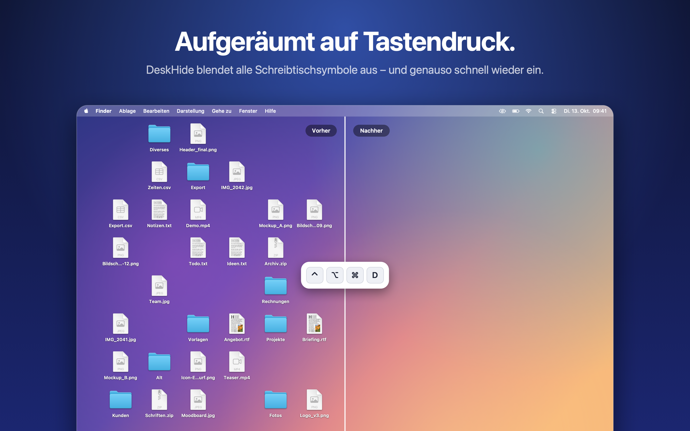

# DeskHide



Blendet per Tastenkürzel alle Schreibtischsymbole aus und wieder ein – für saubere Screenshots.
Es wird nichts verschoben oder gelöscht: Die App schaltet nur die Systemeinstellung
„Schreibtisch & Dock › Objekte anzeigen: Auf dem Schreibtisch“ um. Der Finder läuft dabei weiter.

**[DeskHide herunterladen](https://github.com/Ocean198/DeskHide/releases/latest)** – kostenlos, für Macs
mit Apple-Chip und macOS 14 oder neuer. ZIP entpacken, DeskHide in „Programme“ ziehen, öffnen. Die App
ist von Apple notarisiert.

Entwickelt und getestet wurde auf macOS 27. Sollte das sofortige Ausblenden auf einer anderen
Version nicht greifen, hilft die Option „Vollständig ausblenden“ (siehe unten).

macOS blendet die Objekte nur aus, wenn „Klick auf Hintergrundbild zeigt Schreibtisch“ auf „Immer“
steht. DeskHide stellt das beim Ausblenden selbst so ein und beim Einblenden wieder zurück.
Daraus folgt: Solange die Symbole ausgeblendet sind, holt „Schreibtisch einblenden“ (aktive Ecke,
Geste, Klick auf das Hintergrundbild) sie vorübergehend zurück.

Wer das nicht möchte, aktiviert im Menü **„Vollständig ausblenden (Finder-Neustart)“**. Dann zeichnet
der Finder gar keinen Schreibtisch mehr, und die Symbole bleiben auch bei „Schreibtisch einblenden“
weg. Der Preis: Bei jedem Umschalten startet der Finder kurz neu (1–2 Sekunden, offene Finder-Fenster
schließen sich). Läuft im Finder gerade ein Kopiervorgang, bricht DeskHide das Umschalten ab, statt
ihn zu unterbrechen.

## Bedienung

Beim ersten Start erklärt ein kurzes Einführungsfenster das Wichtigste; über „Einführung anzeigen“
im Menü lässt es sich jederzeit wieder öffnen.

- **⌃⌥⌘D** schaltet um (änderbar im Menü unter „Tastenkürzel ändern …“).
- Das Augen-Symbol in der Menüleiste zeigt den Zustand und enthält alle Optionen:
  Widgets ebenfalls ausblenden, Tastenkürzel ändern, beim Anmelden starten, beenden.
- Beim Beenden blendet die App die Symbole automatisch wieder ein.

Sollten die Symbole einmal ausgeblendet bleiben (z. B. nach einem Absturz): App erneut starten und
Tastenkürzel drücken. Ohne die App hilft im Normalfall der oben genannte Schalter in den
Systemeinstellungen, nach „Vollständig ausblenden“ dieser Befehl im Terminal:

```bash
defaults delete com.apple.finder CreateDesktop; killall Finder
```

## Sicherheit und Ressourcen

- Braucht keine Berechtigungen (keine Bedienungshilfen, keine Bildschirmaufnahme, keine Automation)
  und baut keine Netzwerkverbindungen auf.
- Schreibt ausschließlich Einstellungen: die eigenen, die drei Schreibtisch-Schalter von macOS und
  `CreateDesktop` des Finders. Dateien werden nie angefasst.
- Tastenkürzel werden beim Aufnehmen und beim Laden geprüft; ohne mindestens zwei Sondertasten wird
  nichts systemweit registriert.
- Im Leerlauf 0 % CPU, rund 20 MB Speicher; ein Umschalten dauert unter einer Millisekunde
  (mit Finder-Neustart unter einer Sekunde).

## Bauen

Benötigt die Xcode-Kommandozeilenwerkzeuge und macOS 14 oder neuer. DeskHide läuft ausschließlich auf
Macs mit Apple-Chip.

Liegt ein „Developer ID Application“-Zertifikat im Schlüsselbund, wird damit signiert, sonst nur lokal
(ad hoc). `make dist` braucht zusätzlich einmalig die Zugangsdaten für die Notarisierung:

```bash
xcrun notarytool store-credentials DeskHide --team-id <Team-ID>
```

| Befehl         | Wirkung                                          |
| -------------- | ------------------------------------------------ |
| `make build`   | erzeugt `build/DeskHide.app`                     |
| `make test`    | testet die Umschaltlogik in einer Test-Domain    |
| `make install` | kopiert die App nach `/Applications` und startet sie |
| `make dist`    | notarisiert die App bei Apple und erzeugt `dist/DeskHide-<Version>.zip` |
| `make icon`    | zeichnet das App-Symbol neu (`scripts/make-icon.swift`) |
| `make screenshots` | rendert die Store-Screenshots neu (`scripts/make-screenshots.swift`) |
| `make clean`   | entfernt `build/` und `dist/`                    |

## Symbol und Screenshots

Beides liegt in `assets/` und wird per Skript gezeichnet, nicht von Hand gepflegt:

- `AppIcon.icns` steckt in der App, `AppIcon.appiconset/` enthält dieselben zehn Größen (16 bis
  1024 px) für einen Xcode-Asset-Katalog, `AppIcon-1024.png` ist die Vorlage in voller Größe.
- `screenshots/` enthält drei Bilder in 2880 × 1800 ohne Alphakanal, dem größten Format, das der
  Mac App Store annimmt. Schreibtisch und Menü darin sind gezeichnet, das Einführungsfenster ist
  die echte Ansicht der App.

In den Mac App Store kann DeskHide in dieser Form nicht: Dort ist die App-Sandbox Pflicht, und die
erlaubt weder das Ändern der Schreibtisch-Einstellungen noch den Finder-Neustart.

## Lizenz

MIT – siehe [LICENSE](LICENSE).
